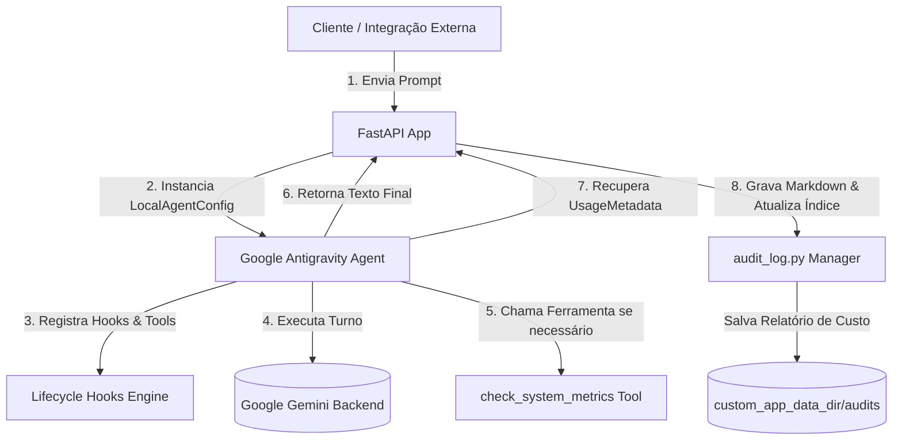

# Google Antigravity Multi-Agent Orchestrator (llm-antigravity-orchestrator) 🌐


> Uma engine avançada e auto-gerenciada de orquestração de agentes autônomos construída sobre o **Google Antigravity (AGY) SDK** oficial (antigo Google ADK), focada em monitoramento minucioso de custos de tokens e tracing de execução em tempo real.

Este repositório serve como base técnica e demonstrativa de como gerenciar de ponta a ponta o ciclo de vida de agentes inteligentes baseados nos modelos Gemini (como Gemini 3.5-flash) integrando **Ganchos de Sessão (Lifecycle Hooks)**, ferramentas customizadas de sistema e a habilidade nativa de delegação assíncrona para subagentes de pesquisa.

---

## 📚 Sumário

- [🧭 Visão Geral](#-visão-geral)
- [🏗️ Arquitetura e Fluxo de Tracing](#-arquitetura-e-fluxo-de-tracing)
- [📁 Estrutura do Repositório](#-estrutura-do-repositório)
- [🛡️ Ciclo de Vida e Hooks do SDK](#-ciclo-de-vida-e-hooks-do-sdk)
- [🛠️ Instalação e Setup](#-instalação-e-setup)
- [🧪 Como Usar (API & Auditorias)](#-como-usar-api--auditorias)
- [✅ Testes e Coverage](#-testes-e-coverage)

---

## 🧭 Visão Geral

Ao projetar sistemas de agentes complexos para produção, a **previsibilidade de custos** e a **rastreabilidade das decisões do agente** são requisitos inegociáveis. O `llm-antigravity-orchestrator` resolve esses gargalos implementando:

1. **Monitoria Avançada de Custos:** Integração direta com `agent.conversation.total_usage` para auditar tokens de Prompt, Geração e *Thinking Tokens* (tokens de pensamento de raciocínio de modelos avançados).
2. **Ganchos de Interceptação (Hooks):** Monitoramento assíncrono de eventos que acontecem antes do turno (`pre_turn`), depois do turno (`post_turn`), e na abertura/fechamento das sessões do agente.
3. **Persistência Confinada (`app_data_dir`):** Armazenamento estruturado e isolado de sessões e relatórios markdown de auditoria em um diretório absoluto definido pelo usuário.
4. **Ferramentas Próprias e Delegação:** Registro de funções Python nativas como ferramentas e ativação de subagentes delegados em segundo plano.

---

## 🏗️ Arquitetura e Fluxo de Tracing

A arquitetura do orquestrador foi desenhada para isolar a camada de serviço FastAPI da lógica do agente e da gravação dos relatórios de auditoria:



---

## 📁 Estrutura do Repositório

```text
llm-antigravity-orchestrator/
├── app/
│   ├── __init__.py
│   ├── config.py             # Configurações de API, diretório de dados e modelo
│   ├── main.py               # Ponto de entrada FastAPI e roteamento de endpoints
│   ├── orchestrator.py       # Configuração do LocalAgentConfig, Agent e Hooks do SDK
│   ├── tools/
│   │   ├── __init__.py
│   │   └── system_metrics.py # Ferramenta customizada do agente (métricas de cluster)
│   └── database/
│       ├── __init__.py
│       └── audit_log.py      # Gerenciamento de escrita de relatórios Markdown de custo
├── tests/
│   ├── __init__.py
│   ├── conftest.py           # Configurações de mocks para testes assíncronos do SDK
│   └── test_orchestrator.py  # Cobertura de testes unitários e de integração
├── .gitignore
├── Dockerfile
├── docker-compose.yml
├── Makefile                  # Automação de tarefas de instalação, execução e testes
└── README.md
```

---

## 🛡️ Ciclo de Vida e Hooks do SDK

Os ganchos (hooks) são recursos nativos do **Google Antigravity SDK** que interceptam momentos cruciais da execução do agente:

* **`@hooks.on_session_start`**: Disparado no início do bloco `async with Agent()`. Útil para configurar variáveis de rastreamento e auditorias corporativas.
* **`@hooks.on_session_end`**: Acionado ao sair do contexto do agente, ideal para consolidar logs de auditoria e salvar históricos de conversação.
* **`@hooks.pre_turn`**: Intercepta a pergunta ou comando enviado ao agente *antes* que a chamada de rede para o modelo seja executada.
* **`@hooks.post_turn`**: Captura a resposta gerada de forma instantânea para salvar transcrições correntes.

---

## 🛠️ Instalação e Setup

### Pré-requisitos
* Python 3.12+ ou Docker/Docker Compose.
* Chave de API do Google Gemini (obtenha gratuitamente no [Google AI Studio](https://aistudio.google.com/app/api-keys)).

### Configuração de Dependências Locais (via Poetry)
Instale as dependências isoladas no seu ambiente de trabalho:
```bash
make install
```

### Rodando o Servidor Localmente
```bash
export GEMINI_API_KEY="sua_chave_aqui"
make run
```
O servidor estará disponível em: `http://localhost:8000`

### Rodando via Docker Compose
Para isolamento de ambiente completo e persistência imediata:
```bash
make docker-up
```

---

## 🧪 Como Usar (API & Auditorias)

### 1. Interagir com o Orquestrador
Dispare um comando para o agente. Exemplo pedindo para ele verificar o status dos nossos clusters (o agente detectará de forma autônoma a necessidade de chamar a ferramenta customizada `check_system_metrics`):

```bash
curl -X POST http://localhost:8000/api/chat \
  -H "Content-Type: application/json" \
  -d '{
    "prompt": "Como está a saúde da nossa infraestrutura e métricas de servidores?"
  }'
```

**Resposta:**
```json
{
  "session_id": "848cb6cc-9c8a-40a1-a476-8806297ea4f9",
  "response": "Olá! O status do nosso cluster de infraestrutura é SAUDÁVEL. Atualmente, o consumo de CPU está em 24.1%, a memória RAM está em 45.2% e o armazenamento de disco em 45.0%. O banco de dados apresenta latência de 0.8ms e o barramento Redis está Ativo.",
  "usage": {
    "prompt_token_count": 128,
    "candidates_token_count": 92,
    "thoughts_token_count": 0,
    "total_token_count": 220
  }
}
```

### 2. Consultar o Painel de Auditoria de Custos
Lista todas as sessões executadas, incluindo o consumo de tokens detalhado por tipo e custo USD de cada uma:

```bash
curl -X GET http://localhost:8000/api/audits
```

### 3. Visualizar Relatório Markdown Detalhado de uma Sessão
Lê o relatório formatado em markdown contendo tabelas de consumo de tokens:

```bash
curl -X GET http://localhost:8000/api/audits/848cb6cc-9c8a-40a1-a476-8806297ea4f9
```

---

## ✅ Testes e Coverage

A suíte de testes unitários e de integração garante que toda a lógica de ganchos de ciclo de vida e salvamento de logs de auditoria esteja robusta e livre de falhas de rede por meio de mocks do Google Antigravity SDK:

Para rodar os testes e gerar o relatório de cobertura de código:
```bash
make coverage
```
Alvo de cobertura mínima garantida: **> 90%**.


---

## 🚀 Execução em Container Isolado (100% Autônomo)

Este repositório é **100% independente e autônomo**. Ele não depende de nenhum outro projeto do ecossistema para ser executado, testado ou analisado.

### 🛠️ Componentes Inclusos na Stack Docker Exclusiva:
- `antigravity_app`: Orquestrador Autônomo Multi-Agente com Google Antigravity SDK.
- `antigravity_postgres`: Banco de dados PostgreSQL dedicado (porta 5434).
- `antigravity_langfuse`: Servidor de observabilidade Langfuse self-hosted pré-inicializado.

### 📦 Como Executar:

1. **Subir toda a pilha isolada**:
   ```bash
   docker-compose up -d --build
   ```

2. **Endpoints & Endereços de Acesso**:
   - **Serviço da Aplicação**: `http://localhost:8002` (Documentação interativa OpenAPI em `/docs` se aplicável)
   - **Painel de Observabilidade (Langfuse)**: `http://localhost:3003`
   - **Credenciais Automáticas do Langfuse**:
     - Email: `admin@llmantigravityorchestrator.com`
     - Senha: `adminpassword123`

3. **Execução de Testes Automatizados em Container**:
   ```bash
   make test
   ```

4. **Encerrar a pilha**:
   ```bash
   docker-compose down -v
   ```
